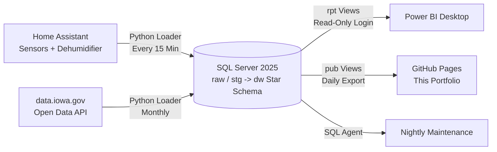

# Data Analysis Portfolio

**rcammerata** · live page: https://rcammerata.github.io/data-portfolio/

Two analytics projects: scheduled loads into **SQL Server**, a **star schema** with stored
procedures and views, and **Power BI** reports. Both refresh on a schedule.

| Project | Question | Data | Uses |
|---|---|---|---|
| [Home Climate Analytics](home-climate/) | Does a home automation keep a home dry, and what does it cost? | My own sensors and dehumidifier, every 5 minutes | time-weighted averages, gaps and islands, JSON in T-SQL, DAX |
| [Retail Sales Analytics](retail-sales/) | Which liquor categories, vendors and stores drive sales in Iowa? | 11,128,561 real sales lines from the State of Iowa (2023-01 to 2026-09) | incremental monthly loads, clustered columnstore, data quality checks, time intelligence |

## How It Runs



* **Loaders** (Python, standard library only) fetch new data and pass it to stored procedures as
  JSON; the procedures shred it with `OPENJSON` and load staging tables.
* **Stored Procedures** clean the data and load dimensions and facts in one transaction each,
  so a failed load never leaves half a month behind. Every step can be re-run safely.
* **Security**: separate logins for loading (`EXECUTE` on the `etl` schema only), reporting
  (`SELECT` on `rpt` only) and publishing (`SELECT` on `pub` only). Connections are encrypted
  with TLS. The database is not reachable from the internet; this page is a one-way export.
* **Operations**: nightly compressed backups with `CHECKSUM` and `RESTORE VERIFYONLY`, a SQL Server
  Agent job for statistics and columnstore maintenance, and health checks with phone alerts.

## Repository Layout

```
home-climate/   sql/ (schema, procedures, views)  etl/ (loader)  powerbi/ (Power BI project)
retail-sales/   sql/                              etl/           powerbi/
docs/           the GitHub Pages site and the published CSV summaries
```

The Power BI reports are saved as Power BI Projects (`.pbip`): the semantic model is plain-text
TMDL (tables, relationships, DAX measures) and the report is JSON, so every change is reviewable
in Git.

*Updated October 31, 2026.*
