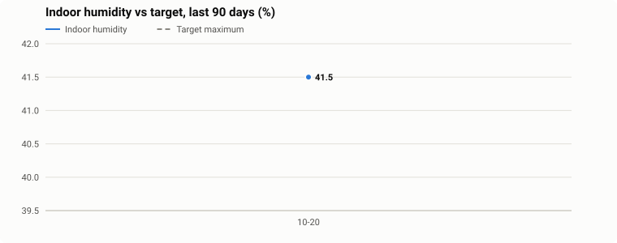
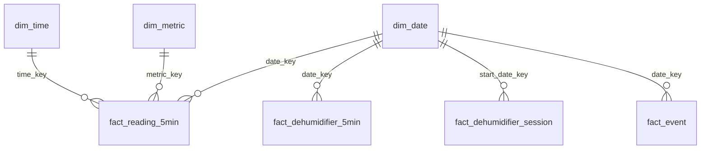

# Home Climate Analytics

**Question:** a home-automation rule turns a dehumidifier to Max, Min or Off based on an indoor
sensor and how much moisture the outside air holds. Does it keep the home inside its target, and
what does running it cost?

**Last 2 days:** average indoor humidity 45.0%, at or below
the target 62% of the time, 28 hours of dehumidifier
runtime. Live charts: https://rcammerata.github.io/data-portfolio/climate.html

## Data

| Source | What | How often |
|---|---|---|
| Indoor Sensor (SwitchBot) | temperature, relative humidity | every 10 minutes |
| Dehumidifier (Midea) | on/off, mode, its own humidity reading | on every change |
| Weather Forecast (Met.no) | outdoor temperature and humidity | hourly |
| The Automation | its decision (Max / Min / Off), the target band | on every change |

Home Assistant records every state change; a Python loader pulls them from its REST API every
15 minutes. Public summaries are hourly, rounded, and three days behind.

## Pipeline and Model

* `raw.ha_state` keeps every change exactly as received (JSON attributes included), so all
  facts can be rebuilt.
* `etl.usp_refresh_climate` rebuilds one time window:
  * **time-weighted 5-minute averages**: each reading counts for as long as it was the current
    value (`LEAD` for the next change, `GENERATE_SERIES` for the buckets, `GREATEST`/`LEAST` for
    the overlap), instead of a plain average of whatever samples arrived;
  * **gaps and islands** to turn on/off changes into dehumidifier runs (the difference of two
    `ROW_NUMBER`s labels each stretch);
  * **events** (the pump emptying the bucket, too hot, mode changes) from `LAG` over each sensor;
  * local time with `AT TIME ZONE`, so a daylight-saving change can't break the day boundaries.
* `rpt.*` views pivot the facts for Power BI (conditional aggregation), apply the sensor's
  calibration, and add the estimated energy use and cost. `rpt.daily_climate` adds a 7-day
  rolling average (window function). Only finished runs are reported.

Files: [`sql/`](sql/) in deployment order, the loader in [`etl/`](etl/).

## Power BI

`powerbi/HomeClimate.pbip` (open in Power BI Desktop). Imported from the `rpt` views through a
read-only login. Measures include time at or below target, runtime hours, estimated kWh and
cost, and average humidity by hour of day and by outdoor moisture.

## Notes

* Energy and cost are estimates: runtime × an assumed power draw × an average electricity price
  (both are settings in `dw.setting`).
* The indoor sensor reads about 5 points low: the reports add 5 to its humidity and to the target
  band set on the same scale (`indoor_humidity_offset` in `dw.setting`); the raw tables keep what
  the sensor sent.
* Sensor gaps are left as gaps; a value is never carried forward for more than 12 hours.
