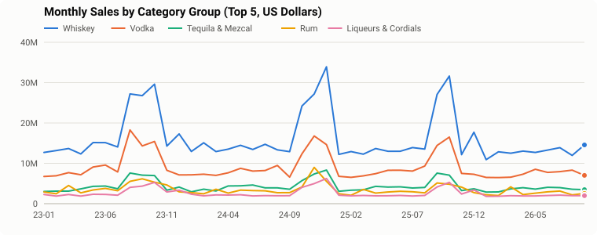
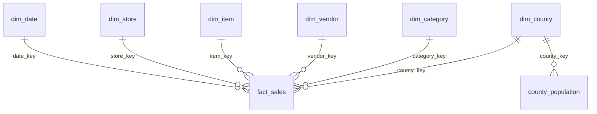

# Retail Sales Analytics

**Question:** in Iowa's liquor market, which categories are growing, which vendors lead, and
which stores and counties sell the most? The State of Iowa is the wholesaler for spirits and
publishes every sale to licensed stores.

**Last 12 months:** {{retail_sales_12m}} in sales (-20.1% vs the 12 months before),
from 11,128,561 sales lines loaded (2023-01 to 2026-09). Live charts:
https://rcammerata.github.io/data-portfolio/retail.html

## Data

[Iowa Liquor Sales](https://data.iowa.gov/catalog?q=liquor+sales), State of Iowa, public domain
(CC0), one dataset per year: one row per item on each store's order, with store, vendor, category,
bottle size, cost and price. County population (another state dataset) adds sales per person.

## Pipeline

* A Python loader downloads each year it needs once (the state's API hands out a whole year as a
  zip of CSV files), reads it in one pass, and parses and validates each line (dates, numbers;
  the yearly files number invoices only, so each line gets `<invoice>-<n>`). It sends each month
  to `etl.usp_stage_iowa` in chunks as JSON (`OPENJSON ... WITH` with positional paths).
* `etl.usp_load_iowa_month` loads a month in **one transaction**: it checks the staged row count
  against the download, adds and updates the dimensions (type 1, latest attributes win only
  when the month is newer), replaces that month's facts (so reloads are idempotent), removes
  duplicate lines, and logs the load.
* Each monthly run reloads the latest two months, because the state corrects recent data.

## Model

* `dw.fact_sales` has a **clustered columnstore index**: millions of rows stay small and
  month/category/vendor aggregations are fast.
* Rows without a store, item, vendor or category go to an "Unknown" member (key -1) instead of
  being dropped, so totals always reconcile with the source.
* Analysis views: `rpt.monthly_category_sales` (year-over-year via a self-join on the same month
  a year earlier, share of month via a windowed `SUM`), `rpt.store_scorecard` (`RANK` within
  county, `NTILE` quartiles).

Files: [`sql/`](sql/) in deployment order, the loader in [`etl/`](etl/).

## Power BI

`powerbi/RetailSales.pbip`. A star schema with a marked date table; measures include sales,
gross margin %, average price per liter, sales prior year, YoY %, year to date and category
share.
